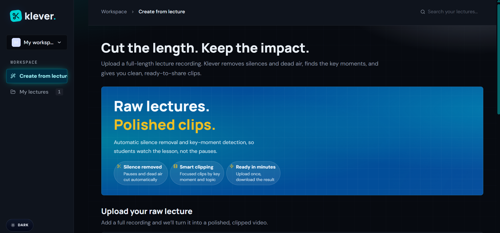

# Klever AI Video Editor

Klever is a local web app for turning long videos into shorter edits. Upload a video, choose whether to remove silence and add topic intro slides, generate an edited video, then preview and download the result.

Uploaded videos are processed on demand with the installed FFmpeg build and pretrained Whisper model; the app does not train on uploaded videos. Video format support depends on the codecs available in FFmpeg. Files without detectable speech are kept as full-length clips because speech-based trimming and topic titles need a transcript.



## Open the Running App

After starting the backend and frontend using the instructions below, open:

- [Klever AI Video Editor](http://localhost:8080/)
- [Backend API documentation](http://localhost:8000/docs)

These links open services on the same computer where the browser is running. Keep both server terminals open; port `8080` is the editor and port `8000` is its backend API.

## Requirements

- Git
- [Bun](https://bun.sh/) or Node.js with npm for the frontend
- Python 3.13 for the backend and Whisper
- FFmpeg and ffprobe available on `PATH`
- Ollama with the `llama3.2` model for generating topic-slide titles; it is optional when topic slides are disabled

## Clone

```powershell
git clone https://github.com/K-Aas-tha/Klever-AI_Video_Editor.git
cd Klever-AI_Video_Editor
```

## Set Up the Backend

In a PowerShell terminal from the repository root:

```powershell
cd backend
py -3.13 -m venv .venv
.\.venv\Scripts\python.exe -m pip install --upgrade pip
.\.venv\Scripts\python.exe -m pip install -r ..\requirements.txt
```

Start the API:

```powershell
.\.venv\Scripts\python.exe -m uvicorn main:app --reload --host 127.0.0.1 --port 8000
```

Keep this terminal open. The first start may download the Whisper model. CPU systems use `tiny` by default; CUDA systems use `base`. To choose a different Whisper model, set `KLEVER_WHISPER_MODEL` before starting the backend, for example:

```powershell
$env:KLEVER_WHISPER_MODEL = "base"
```

To generate topic slides or use Ollama-assisted segment selection, install and start Ollama, then download the model:

```powershell
ollama pull llama3.2
```

Ollama is required when topic slides are enabled so each slide can show a concise title for its transcript section. If topic slides are disabled and Ollama is unavailable, the backend keeps the recognized speech segments by default.

## Set Up the Frontend

Open a second PowerShell terminal at the repository root:

```powershell
cd front_end
npm.cmd install
npm.cmd run dev -- --host 0.0.0.0
```

Open the frontend at [http://localhost:8080/](http://localhost:8080/). Keep this terminal open while using the app. In PowerShell, use `npm.cmd` rather than `npm` if the execution policy blocks `npm.ps1`. With Bun installed, you can use `bun install` and `bun run dev -- --host 0.0.0.0` instead.

The frontend sends API requests to [http://localhost:8000](http://localhost:8000) by default. Start the backend in another terminal as described above. To use a different backend, create `front_end/.env.local` with its base URL:

```dotenv
VITE_API_BASE_URL=http://localhost:8000
```

Restart the frontend after changing `.env.local`.

### Access from another computer on your local network

The browser must use an address reachable from the other computer; `localhost` always refers to the computer running the browser. Start the backend so it listens on the network:

```powershell
.\.venv\Scripts\python.exe -m uvicorn main:app --reload --host 0.0.0.0 --port 8000
```

Find the host computer's private IPv4 address with `ipconfig`. Set `VITE_API_BASE_URL` in `front_end/.env.local` to the backend address, for example `http://192.168.1.25:8000`, then restart the frontend. On the other computer, open `http://192.168.1.25:8080/`. The browser must use the host's address for both services; `localhost` on the other computer refers to that computer itself.

Both computers must be on the same trusted private network. If Windows Firewall blocks access, first mark that trusted Wi-Fi network as **Private** in Windows Settings, then run these commands in an elevated PowerShell window:

```powershell
New-NetFirewallRule -DisplayName "Klever API (Private LAN)" -Direction Inbound -Action Allow -Protocol TCP -LocalPort 8000 -RemoteAddress LocalSubnet -Profile Private
New-NetFirewallRule -DisplayName "Klever frontend (Private LAN)" -Direction Inbound -Action Allow -Protocol TCP -LocalPort 8080 -RemoteAddress LocalSubnet -Profile Private
```

These rules limit access to the local subnet on private networks. Do not expose the development servers directly to the public internet.

## Deploy the Frontend to Vercel

The frontend can be deployed to Vercel, but the video-processing API must run on a separate, publicly reachable backend host. The backend requires Whisper, FFmpeg/ffprobe, and (when topic slides are enabled) Ollama; it also stores uploaded videos and job state on its local disk and in process memory. Vercel's serverless functions are not a suitable host for that long-running processing pipeline.

1. Import this repository into Vercel and set the project root directory to `front_end`. The Vite config selects Nitro's Vercel preset for production builds.
2. Configure `VITE_API_BASE_URL` in the Vercel project's environment variables to the backend's public HTTPS origin, without a trailing slash (for example, `https://api.example.com`).
3. Deploy or redeploy the frontend after setting the variable. Vite embeds `VITE_*` variables at build time.
4. Keep the backend running on a host that provides the required Python packages and media tools. The backend currently allows cross-origin requests; if you later restrict CORS, allow the Vercel deployment's origin.

For local development on the same computer, omit `VITE_API_BASE_URL` to use `http://localhost:8000`. On Vercel, `VITE_API_BASE_URL` must be the backend's public HTTPS URL; do not use `localhost`, since it would refer to each visitor's computer. The `?backend=local` URL option is not supported. See [front_end/.env.example](./front_end/.env.example) for the variable name.

## Use the Editor

1. Choose **Create clips**, then select a video or drag it into the upload area. Common formats such as MP4, MOV, MKV, AVI, WebM, WMV, and MPEG are accepted when the installed FFmpeg build can decode them. Videos must be no larger than 500 MB. The backend checks the actual video stream rather than trusting the filename or browser MIME type. Videos without speech are kept as a full-length clip; speech-based silence removal and topic slides require detectable speech.
2. Review the editing prompt and choose whether to remove silence or add topic intro slides.
3. Select **Generate Video** and follow the progress in the editor.
4. Preview the result and select **Download Edited Video**.

The backend API and interactive documentation are available at [http://localhost:8000/](http://localhost:8000/) and [http://localhost:8000/docs](http://localhost:8000/docs).

## Author

### Aastha Nayak & Sandhya Tiwari

**Machine Learning • Python • Natural Language Processing • FastAPI**

💡 Open to collaboration on Machine Learning, Python, and AI projects.

[](https://github.com/K-Aas-tha)
[](mailto:aasthanayak161@gmail.com)
[](https://www.linkedin.com/in/aastha-nayak-76bb7a34b)
